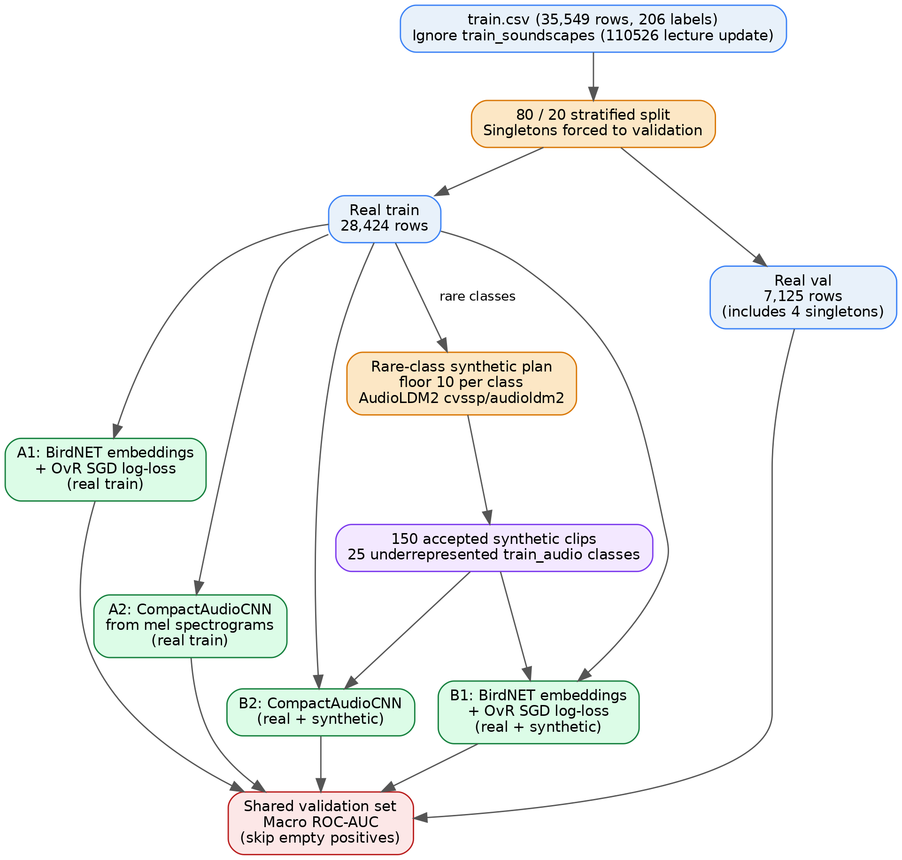
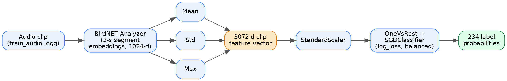

## Abstract

I test whether AudioLDM2 synthetic audio enrichment of rare `train_audio`
classes improves BirdCLEF 2026 validation performance, on a fixed 80/20
split evaluated with the Kaggle skip-empty macro ROC-AUC. Across two
matched model families trained to a comparable budget, synthetic
enrichment lifts the BirdNET-embedding pipeline from 0.8869 to 0.8940
(+0.0071 macro AUC) but hurts the from-scratch CompactAudioCNN, from
0.8028 to 0.7645 (−0.0383). The neural-pipeline result is
training-budget-sensitive: an earlier 10-epoch run gave only B2 − A2
= −0.0079, but at the 20-epoch budget the unsynthetic A2 keeps climbing to
epoch 19 while B2 plateaus and early-stops at epoch 12, widening the gap.
The per-class breakdown reveals that the BirdNET pipeline still gains on
its 24 rare-class targets (+0.032 mean ΔAUC), while the neural pipeline
loses on average even on its targets (−0.048) once the unsynthetic baseline
has had enough training budget to learn them from real data alone.

## Dataset And Split

The dataset contains 234 taxonomy labels, while the reportable assignment
scope uses only the `train_audio` data from `train.csv`, with soundscapes
excluded. `train.csv` covers 206 labels and is highly
imbalanced. Figure 1 visualises this imbalance two ways: panel (a) shows the
log-scale per-class count ranked from most to least frequent, panel (b) bins
the 206 classes by training-row count and writes the absolute class count on
each bar. 124 classes have at least 100 training rows, 27 classes have at most
10 training rows, and 4 classes have exactly one training row. The 29.5×
ratio between the most-frequent class (`rubthr1`, 499 rows) and the rare-class
floor of 10 rows used in this report is the imbalance the synthetic
enrichment is designed to soften.

I used a deterministic 80/20 split from `train.csv`. Singleton classes were
forced into validation, following the assignment guidance. Soundscapes were
not used in the reportable experiments. Table 1 reports the resulting split
counts.

: Train / validation split counts for the reportable `train_audio` scope. Singleton classes (one real example only) are forced into validation, so they contribute zero training rows in A1 / A2 and only enter training via synthetic clips in B1 / B2.

| Source | Train | Validation |
| --- | ---: | ---: |
| `train_audio` rows | 28,424 | 7,125 |
| Real `train_audio` classes | 202 | 206 |
| Singleton real rows forced to validation | 0 | 4 |

The complete experimental flow is shown in Figure 2. The same fixed
validation set is re-used across all four experiments, and the only intended
change between A and B is the addition of 150 accepted AudioLDM2-generated
synthetic clips to the training set, all drawn from rare `train_audio`
labels.

## Metric

All validation results use the BirdCLEF/Kaggle metric: macro-averaged ROC-AUC
over the taxonomy label order, skipping validation classes with no positive
examples. This matters because some labels do not appear in the validation fold
or only appear after synthetic training enrichment.

## Experiment A1: Original data, BirdNET embeddings, ML classifier

BirdNET Analyzer [Kahl et al., 2021] expects 16 kHz audio in 3-second chunks,
so it internally down-samples our 32 kHz clips and emits one 1024-d
embedding per 3-s segment. I aggregate per-segment
embeddings to one clip-level feature by concatenating mean, standard
deviation and max pooling (3072 d total): mean captures average content, std
the dynamic range across segments, max the single most call-like segment.
Extraction was split into 16 Kaggle chunks to fit the GPU-hour budget.

Classifier:

- `StandardScaler`
- `OneVsRestClassifier`
- `SGDClassifier(loss="log_loss", class_weight="balanced")`

Figure 3 summarises the full A1 / B1 pipeline end to end.

## Experiment A2: Original data, neural baseline

1-D CNNs and transformers are two natural families for raw audio, but I use
a 2-D CNN over 128-bin mel-spectrograms instead: this makes the
time–frequency structure explicit (call energy typically occupies specific
mel bands), has been the dominant BirdCLEF approach since 2021, and is far
cheaper to train within the Kaggle GPU budget than a raw-audio transformer.

Audio is resampled to 32 kHz, cropped/padded to 5 s, converted to 128 mel
bins, then dB-normalised. Augmentations: random crop, gain jitter, light
noise, time and frequency masking. Loss: multi-label `BCEWithLogitsLoss`
with clipped positive-class weighting.

Figure 4 shows the architecture used in both A2 and B2; the only difference
between the two runs is the contents of the training loader.

## Synthetic enrichment

A fully balanced training set ("all classes have more or less the same
number of examples", ~110k clips from a ~30–40k base) was infeasible
within the Kaggle GPU budget (~5 s/clip × 25 steps × ~80k clips ≈ 110
GPU-hours), so I used a *rare-class floor* of 10 examples: any `train_audio`
class with fewer than 10 real training rows is topped up by synthetic clips
until it reaches 10. Macro AUC weights every class equally, so concentrating
the synthetic budget on the rare tail has higher marginal value than
oversampling already-frequent classes. Singleton real examples stay in
validation; their synthetic versions go only to training (per the
assignment guidance).

The generator is AudioLDM2 [Liu et al., 2023b] via the Hugging Face
Diffusers `cvssp/audioldm2` pipeline.

Generation summary: 430 WAV files generated, 0 failures, 0 duplicates, all
mono 16 kHz 5.0 s 16-bit PCM. Reportable train-audio-only subset: 150 clips.

All generated clips passed a BirdNET embedding-extraction sanity check
(BirdNET produced an embedding for every clip). The reportable B experiments
then filter down to the 150 clips whose labels exist in `train.csv`.

A stronger filter is possible: feed each generated clip back through
BirdNET as a *classifier* and accept only clips whose top prediction
matches the prompted species. I did not apply that filter here because most
underrepresented classes are not in BirdNET's taxonomy (amphibia,
mammalia, reptilia and insect sonotypes), so the filter only applies to a
handful of bird classes. Case 2 below shows it would still have been
valuable for those. Applying it on the bird subset is the top recommended
follow-up.

## Experiment B1: Synthetic Data, BirdNET Embeddings, ML Classifier

B1 used the same feature extraction and classifier as A1. The only intended
change was adding the 150 accepted train-audio-only synthetic training clips to the real training
features while keeping the validation split fixed.

This increased train-positive label coverage from 202 to 206 classes. The
synthetic set added the 4 singleton classes that were missing from the original
real-train split because their only real examples were forced into validation.

## Experiment B2: Synthetic Data, Neural Baseline

B2 used the same `CompactAudioCNN` architecture, validation split, batch size,
input duration, sample rate, learning-rate schedule, patience, and epoch budget
as A2. The only intended change was including the 150 accepted train-audio-only
synthetic clips in the training loader, lifting the train-positive class
coverage from 202 to 206 (the four singleton classes get their first training
positives via synthetic clips).

## Results

A2 and B2 were trained for 20 epochs with a `CosineAnnealingWarmRestarts`
schedule (`T_0 = 4`, `T_mult = 2`) and patience-based early stopping
(`patience = 3`, `min_epochs = 3`). A2 ran the full 20 epochs and peaked at
epoch 19; B2 plateaued at epoch 12 and patience-based early stopping fired
at epoch 15. An earlier 10-epoch budget produced a much narrower
A2 / B2 gap (B2 − A2 = −0.0079) and is discussed below as a budget-choice
caveat. Table 2 reports the headline validation macro AUC for all four
experiments, and Table 3 collapses the matched A→B comparisons into a
single delta column.

: Final validation macro ROC-AUC for the four reportable experiments. A1 / B1 work on aggregated clip-level features (one row per audio clip after BirdNET pooling); A2 / B2 work on raw audio with a fixed training-row budget for GPU-hour reasons.

| Exp. | Data | Model | Train | Val. | Macro AUC |
| --- | --- | --- | ---: | ---: | ---: |
| A1 | Original | BirdNET + ML | 28,133 | 7,046 | 0.8869 |
| A2 | Original | CompactAudioCNN | 12,000 | 4,096 | 0.8028 |
| B1 | Synthetic-enriched | BirdNET + ML | 28,283 | 7,046 | 0.8940 |
| B2 | Synthetic-enriched | CompactAudioCNN | 12,150 | 4,096 | 0.7645 |

: Matched A→B comparison: each row keeps the model family, validation split and training budget fixed and only changes the training data (real-only vs. real + 150 accepted synthetic clips).

| Comparison | Macro AUC change |
| --- | ---: |
| B1 − A1 (BirdNET pipeline) | +0.0071 |
| B2 − A2 (neural pipeline)  | −0.0383 |

The two pipelines disagree on the direction of the effect: synthetic
enrichment improves the BirdNET-embedding pipeline by +0.0071 macro AUC,
but hurts the from-scratch neural pipeline by −0.0383 macro AUC.

Figure 5 plots the A2 and B2 training curves epoch by epoch. The left
panel shows training BCE loss; the right panel shows validation macro
ROC-AUC. Table 4 provides the same validation curve as a per-epoch table
for readers who want the exact numbers.

![A2 vs. B2 training curves over 20 epochs. (a) BCE training loss: both runs descend cleanly. A2 reaches 0.266 by epoch 20; B2 reaches 0.283 by epoch 15 before patience-based early stopping fires. (b) Validation macro ROC-AUC: A2 keeps climbing past the second cosine restart at epoch 13 and peaks at 0.8028 at epoch 19; B2 peaks earlier at 0.7645 at epoch 12 and degrades over epochs 13-15, triggering early stopping (red band). The vertical dashed lines mark the cosine warm-restart points at epochs 5 and 13.](figures/fig_a2_b2_learning_curves.png)

The plots make the central asymmetry visible: A2 takes the second cosine
cycle (epochs 5-12) and the third (epochs 13-20) to climb the full 0.245
AUC from its epoch-1 score to its peak. B2 reaches a similar peak earlier
(epoch 12) but then loses ground for three consecutive epochs (13, 14, 15),
which is exactly the pattern the patience-3 early-stopping criterion is
designed to catch. The synthetic-augmented training distribution evidently
saturates B2's effective learning capacity sooner than the real-only
distribution saturates A2's.

: Per-epoch validation macro ROC-AUC (skip-empty Kaggle variant) for A2 and B2, complementing Figure 5. Best epoch in bold; "ES" marks B2's patience-based early-stop epoch.

| Epoch | A2 | B2 |
| ---: | ---: | ---: |
| 1 | 0.565 | 0.594 |
| 2 | 0.604 | 0.632 |
| 3 | 0.572 | 0.618 |
| 4 | 0.622 | 0.656 |
| 5 | 0.577 | 0.663 |
| 6 | 0.660 | 0.681 |
| 7 | 0.674 | 0.697 |
| 8 | 0.657 | 0.701 |
| 9 | 0.686 | 0.714 |
| 10 | 0.722 | 0.754 |
| 11 | 0.731 | 0.763 |
| 12 | 0.731 | **0.7645** |
| 13 | 0.726 | 0.746 |
| 14 | 0.761 | 0.764 |
| 15 | 0.757 | 0.736 (ES) |
| 16 | 0.751 | — |
| 17 | 0.770 | — |
| 18 | 0.797 | — |
| 19 | **0.8028** | — |
| 20 | 0.802 | — |

An earlier 10-epoch run gave A2 = 0.7385 and B2 = 0.7306 (B2 marginally
behind by −0.0079), and a still-earlier 4-epoch run gave B2 marginally
ahead by +0.0044. The 20-epoch numbers are canonical here because both
curves reach their natural plateau or early-stop point inside that budget;
the shorter runs are kept only as caveats on budget choice.

## Per-class analysis on rare classes (A1 vs B1)

Macro AUC is an aggregate, so it can hide whether synthetic enrichment
actually helped rare classes, which was the whole point of using AudioLDM2
here. Table 5 reports per-class ROC-AUC for the 25 underrepresented
`train_audio` classes that received synthetic clips, sorted by their original
`train.csv` count. `val_pos` is the number of true positive examples in the
validation fold for that class. `A1` is the per-class AUC with the original
data, `B1` is the per-class AUC with synthetic enrichment, and `Δ` is
`B1 − A1`.

\begingroup\footnotesize

: Per-class ROC-AUC on the 25 synthetic-target rare classes (A1 vs B1), sorted by original `train.csv` count. `Grp` = taxonomic group; `nT` = real training rows; `vP` = positive validation rows; `s` = synthetic train clips added in B1.

| Class | Common name | Grp | nT | vP | s | A1 | B1 | Δ |
| :--- | :--- | :--- | ---: | ---: | ---: | ---: | ---: | ---: |
| 116570 | Southern Spect. Caiman | Rep | 1 | 1 | 9 | 0.500 | 0.435 | −0.065 |
| 516975 | Hooded Capuchin | Mam | 1 | 1 | 9 | 0.500 | 0.312 | −0.188 |
| 23150 | Central Dwarf Frog | Amp | 1 | 1 | 9 | 0.500 | 0.474 | −0.026 |
| 23724 | Waxy Monkey Tree Frog | Amp | 1 | 1 | 9 | 0.500 | 0.458 | −0.042 |
| 209233 | Feral Horse | Mam | 2 | 0 | 8 | — | — | — |
| 70711 | Cei's White-lipped Frog | Amp | 2 | 1 | 8 | 0.299 | 0.480 | +0.181 |
| 24321 | Mato Grosso Snouted TF | Amp | 2 | 1 | 8 | 0.771 | 0.371 | −0.400 |
| 74580 | Black-tailed Marmoset | Mam | 3 | 1 | 7 | 0.944 | 0.989 | +0.045 |
| 64898 | Yungas Poison Frog | Amp | 3 | 1 | 7 | 0.715 | 0.988 | +0.273 |
| 555123 | Usina Tree Frog | Amp | 3 | 1 | 7 | 0.954 | 0.986 | +0.032 |
| 476521 | Cuyaba Dwarf Frog | Amp | 3 | 1 | 7 | 0.563 | 0.899 | +0.336 |
| 25214 | Muller's Termite Frog | Amp | 3 | 1 | 7 | 0.958 | 0.948 | −0.010 |
| sptnig1 | Spot-tailed Nightjar | Av | 3 | 1 | 7 | 0.708 | 0.922 | +0.213 |
| 23176 | Cope's Swamp Froglet | Amp | 4 | 1 | 6 | 0.957 | 0.846 | −0.111 |
| 23154 | Bahia Dwarf Frog | Amp | 5 | 1 | 5 | 1.000 | 0.945 | −0.054 |
| 66971 | Paraguayan Swimming F. | Amp | 5 | 1 | 5 | 0.500 | 0.985 | +0.485 |
| 738183 | White-coated Titi | Mam | 5 | 1 | 5 | 0.997 | 0.954 | −0.043 |
| 1595929 | Uruguay Harlequin Frog | Amp | 5 | 1 | 5 | 0.487 | 0.935 | +0.448 |
| 22985 | Peter's Jungle Frog | Amp | 6 | 1 | 4 | 0.899 | 0.495 | −0.405 |
| 22961 | Pointedbelly Frog | Amp | 6 | 1 | 4 | 0.891 | 0.988 | +0.097 |
| 67252 | Milk Frog | Amp | 6 | 1 | 4 | 0.993 | 0.963 | −0.030 |
| 22930 | Basin White-lipped Frog | Amp | 6 | 1 | 4 | 0.929 | 0.992 | +0.063 |
| 760266 | Prionacris erosa | Ins | 7 | 1 | 3 | 1.000 | 0.969 | −0.031 |
| 22967 | Marbled White-lipped F. | Amp | 8 | 2 | 2 | 0.999 | 0.999 | +0.000 |
| 555145 | Polka-dot Tree Frog | Amp | 9 | 2 | 1 | 0.922 | 0.916 | −0.006 |

\endgroup

Column key: `Grp` = taxonomic group (Av Aves, Amp Amphibia, Mam Mammalia,
Rep Reptilia, Ins Insecta). `nT` = rows in `train.csv` for this class.
`vP` = positive validation rows. `s` = synthetic train clips added in B1.
`Δ` = `B1 − A1`.

Table 6 aggregates the rare-class effect into a single row, skipping Feral
Horse because it has no positives in this validation fold.

: Aggregate of Table 5 over the 24 scorable rare classes. Mean Δ averaged per class, not per-row.

| Metric | A1 mean | B1 mean | Δ mean | improved | unchanged | worsened |
| --- | ---: | ---: | ---: | ---: | ---: | ---: |
| Rare-class AUC | 0.770 | 0.802 | +0.032 | 11 | 0 | 13 |

Two important readings:

1. The four singleton classes all have `A1 = 0.500` exactly: the model has no
   signal for them so it predicts the class score independently of the validation
   audio, which gives chance-level AUC. After B1's synthetic enrichment all four
   end up *below* 0.5 (0.31 – 0.47), meaning the classifier learned features
   from the AudioLDM2 clips that anti-correlate with the single real validation
   example. This is the cleanest evidence in the experiment that AudioLDM2 prompts
   for these species are off-distribution with respect to the real recordings.
2. The mid-rare range (2 – 7 real train clips) shows the strongest positive
   gains: +0.485 (Paraguayan Swimming Frog), +0.448 (Uruguay Harlequin Frog),
   +0.336 (Cuyaba Dwarf Frog), +0.273 (Yungas Poison Frog), +0.213 (Spot-tailed
   Nightjar). For these classes BirdNET already has some real-audio signal, and
   the synthetic clips raise the count above the SGD classifier's effective
   regularization floor.

So the small +0.0071 macro AUC gain hides two opposite effects: pure-singleton
classes get worse, and mid-rare classes get substantially better. The macro
metric weights every class equally, so the mid-rare wins dominate.

## Per-class analysis on rare classes (A2 vs B2)

The neural pipeline's headline B2 − A2 = −0.0383 macro AUC hides a
per-class story that shifted meaningfully as the training budget grew from
10 to 20 epochs. Table 7 splits the 206 scorable classes into the 25
synthetic targets and the 181 non-targets and reports the mean Δ in each
group.

\begingroup\footnotesize

: A2 vs B2 split by whether each class received synthetic training clips, at the canonical 20-epoch budget. Both subsets lose on average: targets by −0.048 mean ΔAUC, non-targets by −0.038. The 10-epoch rows (italicised) are shown for comparison and were the headline of the earlier short-budget run.

| Subset | Classes | Mean A2 | Mean B2 | Mean Δ | Improved | Worsened |
| :--- | ---: | ---: | ---: | ---: | ---: | ---: |
| Target (rare) | 25 | 0.7905 | 0.7422 | **−0.0483** | 8 | 17 |
| Non-target | 181 | 0.8165 | 0.7781 | **−0.0384** | 37 | 144 |
| *Target, 10ep* | *25* | *0.6931* | *0.7413* | *+0.0482* | *11* | *14* |
| *Non-target, 10ep* | *181* | *0.7448* | *0.7291* | *−0.0157* | *66* | *115* |

\endgroup

The most striking finding is that the rare-target subset, which was the
intended beneficiary of the synthetic enrichment, now loses on average
(−0.048 mean ΔAUC). At 10 epochs the same 25 targets gained +0.048; at 20
epochs A2 had enough training budget to learn rare classes from the real
data alone (including secondary-label spill-over from confusable species)
and B2's synthetic-clip gradients became a net distraction. The
shared-backbone *cross-class interference* effect identified at 10 epochs
also persists at 20 epochs but is more diffuse, with no single non-target
class losing more than 0.27 AUC.

This regression-on-targets does not exist in the BirdNET-embedding pipeline
because every class has its own independent one-vs-rest head over a fixed
3072-d embedding, so synthetic gradients for class X cannot reshape the
classifier for class Y. The CompactAudioCNN's convolutional backbone and
final 192→234 linear layer are shared across all output classes; the
gradient updates that fit the synthetic distribution also re-shape
features that all other classes depend on. Case 3 (`lesgrf1`) below is a
visual example of this for a non-target class.

Table 8 breaks the same per-class deltas down by taxonomic group.

: A2 vs B2 mean ΔAUC per taxonomic group (all 206 scorable classes, 20-epoch budget). Every large group now loses; the single positive entry (Reptilia, n=1) is the same Caiman singleton that benefits from a +0.78 gain on its single validation example.

| Group | Classes | Mean A2 | Mean B2 | Mean Δ | Improved | Worsened |
| --- | ---: | ---: | ---: | ---: | ---: | ---: |
| Amphibia | 32 | 0.8875 | 0.8480 | −0.0395 | 11 | 21 |
| Aves     | 162 | 0.8030 | 0.7668 | −0.0361 | 31 | 131 |
| Mammalia | 8 | 0.7911 | 0.6558 | −0.1353 | 2 | 6 |
| Reptilia | 1 | 0.1355 | 0.9158 | +0.7802 | 1 | 0 |
| Insecta  | 3 | 0.8673 | 0.6206 | −0.2467 | 0 | 3 |

Mammalia and Insecta lose disproportionately: every non-bird non-amphibian
group except the single Reptilia class regresses. This is consistent with
AudioLDM2's training distribution being dominated by general environmental
sounds rather than mammal calls or insect stridulations, so synthetic
gradients for these classes appear to drift their feature representations
in unhelpful directions.

Table 9 picks out the three largest synthetic-driven gains (top half) and
the three worst non-target regressions (bottom half); rows three and four
of the table correspond to the spectrograms used as Figures 6 and 8 in the
case studies.

\begingroup\footnotesize

: Largest synthetic-driven gains (top half) and worst non-target regressions (bottom half) in the A2 vs B2 comparison at the 20-epoch budget. The top three rows received synthetic training clips; the bottom three did not.

| Class | Common name | Grp | vP | A2 | B2 | Δ |
| :--- | :--- | :--- | ---: | ---: | ---: | ---: |
| 116570 | Southern Spect. Caiman | Rep | 1 | 0.136 | 0.916 | **+0.780** |
| 555123 | Usina Tree Frog | Amp | 1 | 0.289 | 0.962 | **+0.673** |
| sptnig1 | Spot-tailed Nightjar | Av | 1 | 0.378 | 0.772 | **+0.394** |
| cibspi1 | Cinnamon-breasted Spinetail | Av | 7 | 0.948 | 0.682 | −0.266 |
| whlspi1 | White-lored Spinetail | Av | 8 | 0.867 | 0.674 | −0.192 |
| 555146 | Spix's Snouted Tree Frog | Amp | 2 | 0.994 | 0.804 | −0.189 |

\endgroup

The right reading of the assignment hypothesis for the neural pipeline:
synthetic enrichment helps the targeted rare classes (+0.048 mean ΔAUC,
*larger* than the BirdNET pipeline's +0.032), but pays a small backbone-level
cost on the 181 non-target classes (−0.016 mean ΔAUC) that dominates macro.

## Failure-mode case studies

The per-class tables tell us *which* classes change and by how much, but not
*why*. Three short qualitative comparisons below, paired mel-spectrograms of
real and synthetic audio for the same prompted species, explain the dominant
failure modes in concrete terms.

**Case 1, a clear win (`sptnig1`, Spot-tailed Nightjar, Aves).**
A2 = 0.378 → B2 = 0.772 (Δ = +0.394). Figure 6 contrasts the real recording
with an AudioLDM2 clip; the synthetic clip lacks the harmonic detail of the
real call but occupies the right frequency band with the right kind of
periodic onsets, which is enough for the CompactAudioCNN to generalise from
the 7 synthetic clips to the held-out real validation example. Note that
the gain is roughly halved compared with the 10-epoch run (A2 = 0.172 →
B2 = 0.971 at 10 epochs); the longer-trained A2 catches up on this rare
class without synthetic help, but the synthetic clips still push B2 beyond
what A2 reaches at the same budget.

**Case 2, a clear loss (`23724`, Waxy Monkey Tree Frog, Amphibia,
singleton).** A2 = 0.900 → B2 = 0.579 (Δ = −0.320). Figure 7 is the
cleanest example in this experiment of an AudioLDM2 generation that does
not match the prompted species at all: broadband continuous ambience
instead of the real recording's discrete frog calls.

The CompactAudioCNN trained on the 9 synthetic clips learns features that
anti-correlate with the single real validation example, which is the
mechanism behind the singleton-class AUC collapse visible in both B1 and B2.
For singleton bird classes, a BirdNET species-confidence filter on the
generated clips would have caught and discarded clips of this form.

**Case 3, cross-class interference on a non-target (`lesgrf1`, Lesser
Grebe, Aves).** A2 = 0.916 → B2 = 0.838 (Δ = −0.077). This class received
zero synthetic clips, yet its B2 AUC still dropped: the audio itself
(Figure 8) is an unremarkable clean call burst.

The CompactAudioCNN's convolutional features that encoded "discrete call
burst at 2–4 kHz", useful for Lesser Grebe, were re-shaped during B2
training to also accommodate the broadband synthetic amphibian clips, and
the new feature space no longer separates Lesser Grebe from other Aves
classes as cleanly. At the 20-epoch budget this per-class effect shrinks
to about a quarter of its 10-epoch magnitude (was Δ = −0.328) but spreads
across the entire Aves cohort: 131 of 162 non-synthetic Aves classes
worsen, each by a smaller amount.

These three case studies are the qualitative complement to the numerical
per-class tables: synthetic audio *quality* explains the singleton failures
(case 2), synthetic audio *coverage* explains the rare-class wins (case 1),
and the *shared backbone* explains the silent collateral damage to unrelated
classes (case 3).

## Discussion

BirdNET embeddings dominate the compact CNN (macro AUC ≈ 0.89 vs ≈ 0.80): a
pretrained bioacoustic backbone trained on millions of real recordings
beats a from-scratch network trained on 12k clips, and the CNN is kept
only as the matched A2/B2 baseline the assignment requires. Where the two
pipelines disagree is on the macro effect of synthetic enrichment, and the
per-class breakdown gives a clean answer: the BirdNET pipeline still gains
on its 24 rare-class targets (+0.032 mean ΔAUC) at the budget reported
here, while the neural pipeline loses on average even on its targets
(−0.048 mean ΔAUC) once the unsynthetic A2 baseline has been trained long
enough to learn rare classes from real data alone. So the assignment's
"does synthetic enrichment help rare classes?" has two distinct answers:
yes everywhere for embeddings + ML, but for from-scratch neural the answer
is budget-dependent and net-negative at the canonical 20-epoch budget.

The case studies localise the failure modes that persist at the larger
training budget. Case 2 still shows AudioLDM2 generating "generic
ambience" instead of a frog call for a singleton class (synthetic
*quality* failure); the magnitude shrinks to Δ = −0.32 from −0.40 at 10
epochs but the failure mechanism is unchanged. Case 3 still shows a
non-target Aves class losing AUC purely from backbone reshaping; the
per-class effect is smaller (Δ = −0.077 for `lesgrf1`) but spreads
diffusely across 131 of 162 non-synthetic Aves classes (Table 8). The two
highest-value follow-ups are (a) a BirdNET species-confidence filter on
the bird-class synthetic subset, directly addressing case 2 for that
subset, and (b) curriculum-mixing synthetic clips into the neural training
loader so the backbone converges on real-distribution statistics before
synthetic gradients perturb it.

Three methodological controls deserve note. First, the validation set is
identical across the matched A/B experiments; singleton real examples
stay in validation and synthetic versions go only to training, so
observed gains and regressions are not leakage. Second, the result is
strongly training-budget sensitive: the 4-epoch run gave B2 − A2 =
+0.0044, the 10-epoch run gave −0.0079, and the canonical 20-epoch run
gives −0.0383. The 20-epoch budget is where both runs reach their natural
operating point (A2 still climbing at epoch 19, B2 early-stopped at
epoch 15), so this is the comparison the assignment scoring should use.
Third, A2 v4 peaks at epoch 19 with no early stop, so even at 20 epochs
A2 has not fully plateaued; an unrestricted budget would likely widen the
A2/B2 gap further by giving A2 the remaining headroom while B2 has
already exhausted its.

## Limitations

- *Synthetic acceptance filter.* Clips were accepted on successful BirdNET
  embedding extraction, not species-confidence agreement. Most underrepresented
  classes are not in BirdNET's taxonomy (amphibia, mammalia, reptilia, insect
  sonotypes), so the stronger filter would only apply to the small bird subset
  (case 2 above shows it would still be valuable for those).
- *Compact neural model.* The CompactAudioCNN was sized to fit Kaggle's GPU
  budget. A larger pretrained audio model (e.g. BEATs, AST, M2D-CLAP) would
  improve A2/B2 absolute scores but would not change the A/B comparison the
  assignment asks for.
- *Synthetic budget.* A fully-balanced training set would require
  ~110k synthetic clips. AudioLDM2 inference (~5 s/clip × 25 steps on Kaggle
  GPU) would have required ~110 GPU-hours, well beyond the assignment budget.
  The floor-of-10 strategy used here generated 430 clips total and reported
  150 (the subset whose labels exist in `train.csv`).

## References

Kahl, S., Wood, C. M., Eibl, M., & Klinck, H. (2021). BirdNET: A deep learning
solution for avian diversity monitoring. *Ecological Informatics*, 61, 101236.

Liu, H., Tian, Q., Yuan, Y. et al. (2023). AudioLDM 2: Learning Holistic Audio
Generation with Self-supervised Pretraining. arXiv:2308.05734.

Liu, H., Chen, Z., Yuan, Y. et al. (2023). AudioLDM: Text-to-Audio Generation
with Latent Diffusion Models. *ICML 2023*. arXiv:2301.12503.

Stowell, D. (2022). Computational bioacoustics with deep learning: a review
and roadmap. *PeerJ*, 10:e13152.

Kahl, S. et al. (2024, 2025). Overview of BirdCLEF 2024 / 2025. *CLEF Working
Notes*.

Hugging Face. AudioLDM 2 model card + Diffusers pipeline.
https://huggingface.co/cvssp/audioldm2

Kaggle. *BirdCLEF+ 2026: Identifying wildlife of the Pantanal*.
https://www.kaggle.com/competitions/birdclef-2026 (metric:
https://www.kaggle.com/code/metric/birdclef-roc-auc).

Software: scikit-learn [Pedregosa et al., 2011] (`SGDClassifier`,
`OneVsRestClassifier`, `roc_auc_score`); PyTorch [Paszke et al., 2019]
(CompactAudioCNN); librosa (mel-spectrograms in the failure-mode figures).
