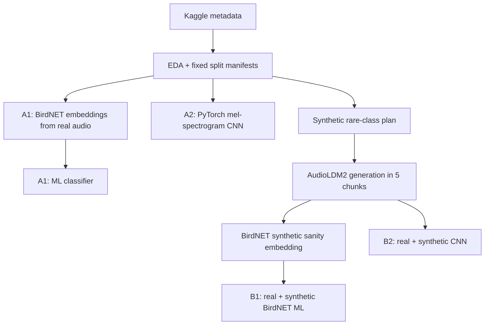
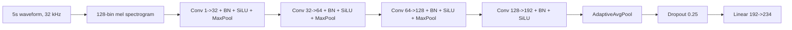

# COMPX525 Assignment 2 Çalışma ve Savunma Rehberi

Bu dosya rapor değildir. Amacı, bu ödev için yazdığımız kodları, yaptığımız
deneyleri ve aldığımız kararları gerektiğinde rahatça açıklayabilmen için
çalışma notu sağlamaktır.

## 2 Dakikalık Kısa Anlatım

Bu ödevde BirdCLEF 2026 ses sınıflandırma problemi için dört deney yaptım.
Önce orijinal veri üzerinde BirdNET embedding çıkarıp klasik bir ML modeli
eğittim. Sonra orijinal veri üzerinde mel-spectrogram girdili küçük bir PyTorch
CNN eğittim. Daha sonra az örnekli ve train setinde eksik kalan sınıflar için
AudioLDM2 ile synthetic sesler ürettim, bu synthetic sesleri sadece training
setine ekledim ve aynı iki modeli tekrar çalıştırdım.

Validation split bütün karşılaştırmalarda sabit tutuldu. `train.csv` için
80/20 split yaptım, singleton sınıfları özellikle validation setine koydum.
Hocanın 110526 lecture update'inden sonra soundscape verilerini rapor dışı
bıraktım; reportable deneyler sadece `train_audio` üzerinden gidiyor.

Sonuçta synthetic enrichment iki model ailesinde de validation skorunu artırdı:
BirdNET+ML modeli 0.8869'dan 0.8940'a çıktı; neural CNN modeli 0.6451'den
0.6494'e çıktı. Raporun ana hikayesi bu: aynı validation seti ve aynı model
ailesi içinde sadece training verisine synthetic rare-class örnekler eklenince
performans iyileşti.

## Ödevin Resmi İsteği

README ve NotebookLM'deki 040526 lecture kaydının başındaki yönerge aynı ana
şeyi söylüyor:

1. Veriyi 80% train, 20% validation olarak ayır.
2. Orijinal veri üzerinde BirdNET embedding + bir ML algoritması dene.
3. Orijinal veri üzerinde kendi neural mimarini eğit veya BirdNET fine-tune et.
4. Synthetic ses üretip training verisini zenginleştir.
5. Synthetic zenginleştirilmiş veriyle BirdNET embedding + ML deneyini tekrar et.
6. Synthetic zenginleştirilmiş veriyle neural/fine-tune deneyini tekrar et.
7. Singleton sınıfları validation setinde tut.
8. Synthetic sesleri mümkünse BirdNET ile sanity-check/filter et.
9. Moodle'a yaklaşımı, ağ diyagramlarını ve sonuç tartışmasını içeren PDF rapor yükle.

110526 lecture update:

- Sadece `train_audio` kullan.
- Soundscapes'i ignore et; hoca bunların bu ödev için fazla zor olduğunu söyledi.
- Bu yüzden eski soundscape-inclusive synthetic sonuçları rapor dışı/ara çalışma.

Biz bunların tamamını karşıladık. Kaggle leaderboard skoru assignment için ana
ölçüt değil; Moodle PDF raporu asıl not kaynağı.

## AudioLM2 / AudioLDM2 Konusu

README ve lecture notlarında `AudioLM2` adı geçiyor. Ben güncel açık kaynak ve
çalıştırılabilir model olarak bu isimle bir model bulamadım. Kullandığımız
model `AudioLDM2`, yani `cvssp/audioldm2`.

Bunu raporda saklamamak gerekiyor. Doğru açıklama şu:

> The brief refers to AudioLM2. I could not identify a public model with that
> exact name, so I used the publicly available AudioLDM2 text-to-audio pipeline
> as a reproducible implementation of the requested synthetic text-to-audio
> enrichment step.

Bu bizi zayıflatmaz; aksine reproducibility açısından daha doğru.

## Veri Setini Nasıl Anladık?

Reportable ana kaynak dosyalar:

- `train.csv`: ana training audio metadata.
- `taxonomy.csv`: hedef class listesi.
- `sample_submission.csv`: Kaggle submission kolon sırası.
- `recording_location.txt`: kayıt lokasyonu, Pantanal.

Önemli sayılar:

| Bilgi | Değer |
| --- | ---: |
| Taxonomy target class sayısı | 234 |
| `train.csv` row sayısı | 35,549 |
| `train.csv` içindeki class sayısı | 206 |
| Singleton `train.csv` class sayısı | 4 |

Neden `sample_submission.csv` kolon sırasını kontrol ettik?

Kaggle metric prediction kolonlarını label olarak okur. Kolon sırası taxonomy
ile uyuşmazsa model doğru skor üretse bile yanlış label'a yazılmış olur.
Notebook başlangıcında `sample_submission.csv` label kolonlarını `taxonomy.csv`
ile karşılaştırarak bu kontratı doğruladık.

## Split Stratejisi

Split kodu ana notebook içindedir:

- `notebooks/compx525_a2_birdclef_kaggle.py`
- Fonksiyonlar:
  - `make_train_audio_split`

Split sonucu:

| Kaynak | Train | Validation |
| --- | ---: | ---: |
| `train_audio` row | 28,424 | 7,125 |
| Singleton validation row | 0 | 4 |

Neden singleton'ları validation'a koyduk?

README açıkça bunu istiyor. Tek örneği train'e koyarsak validation'da o class
için gerçek ölçüm yapamayız. Ayrıca synthetic deneyin amacı da burada görülür:
A deneyinde bu singleton class'lar training'de olmadığı için zor olacak; B
deneyinde synthetic örnekleri training'e ekleyip bu class'lar için modelin bir
şey öğrenmesini sağlıyoruz.

Neden soundscape kullanmıyoruz?

İlk pipeline soundscape label'larını analiz ediyordu, fakat 110526 lecture
update'inde hoca soundscape'lerin çok zor olduğunu ve assignment için sadece
`train_audio` kullanmamız gerektiğini söyledi. Bu yüzden rapor ve final
sonuçlarda soundscape verilerini kullanmıyoruz.

## Metric

Kaggle metric, macro ROC-AUC'nin BirdCLEF uyarlaması:

- Her label için ROC-AUC hesaplanıyor.
- Validation tarafında hiç positive örneği olmayan label'lar skip ediliyor.
- Kalan class AUC'lerinin ortalaması alınıyor.

Kod tarafı:

- `kaggle_macro_auc_skip_empty`

Neden accuracy değil?

Problem multi-label probability prediction problemine yakın. Submission formatı
her 5 saniyelik row için her species/class olasılığını istiyor. Bu yüzden
probability ranking kalitesini ölçen ROC-AUC daha uygun.

## Genel Pipeline



Ana çalışma şekli Kaggle-first idi. Raw audio dosyalarını lokalde indirmedik.
Bunun nedeni veri boyutu ve local makine/GPU sınırlamalarıydı.

## A1: Orijinal Veri + BirdNET Embedding + ML

Amaç:

Orijinal training audio'dan BirdNET embedding çıkarıp klasik bir ML classifier
ile validation prediction üretmek.

Kod yüzeyi:

- Ana notebook: `notebooks/compx525_a2_birdclef_kaggle.py`
- Kernel hazırlayıcı: `scripts/prepare_birdnet_chunk_kernel.py`
- ML kernel hazırlayıcı: `scripts/prepare_birdnet_ml_kernel.py`
- A1 output: `kaggle_outputs/birdnet_ml_full_a1_v1/birdnet_ml_baseline_summary.json`

BirdNET neden kullanıldı?

BirdNET bioacoustic seslerde pretrained bir modeldir. Biz BirdNET'in son
classification head'ini değil, embedding temsilini kullandık. Bu embeddingler
audio'nun biyolojik ses içeriğini compact bir feature vector olarak temsil eder.

Neden chunk'lara böldük?

Full BirdNET extraction uzun sürüyordu. Benchmark yaklaşık 128 dosya için
207.7 saniyeydi. Bütün audio'yu tek notebookta çalıştırmak riskliydi. Kaggle
timeout, disk ve session limitlerinden etkilenmemek için extraction'ı 16 chunk'a
böldük.

Feature nasıl oluştu?

BirdNET segment başına 1024 boyutlu embedding üretiyor. Bir clip içinde birden
fazla segment olabilir. Biz clip-level feature için üç aggregation kullandık:

- mean
- standard deviation
- max

Bu yüzden final clip feature boyutu:

```text
1024 mean + 1024 std + 1024 max = 3072
```

Classifier:

- `StandardScaler`
- `OneVsRestClassifier`
- `SGDClassifier(loss="log_loss", class_weight="balanced")`

Neden bu classifier?

234 label için multi-label probability üretmemiz gerekiyor. One-vs-rest her
class için ayrı binary classifier mantığı kurar. `log_loss` logistic
probability üretir. `class_weight="balanced"` rare class imbalance etkisini
azaltmaya çalışır. `SGDClassifier` büyük feature matrix için hızlı ve pratik.

A1 sonucu:

| Bilgi | Değer |
| --- | ---: |
| Joined feature row | 35,179 |
| Train row | 28,133 |
| Validation row | 7,046 |
| Feature dimension | 3,072 |
| Train positive class | 202 |
| Validation positive class | 205 |
| Validation macro AUC | 0.8869 |

A1'i nasıl anlatırım?

> BirdNET'i feature extractor gibi kullandım. Segment embeddinglerini clip
> seviyesinde mean/std/max ile birleştirdim. Sonra 234 class için one-vs-rest
> logistic classifier eğittim. Bu pretrained bioacoustic representation olduğu
> için compact CNN'e göre daha güçlü bir baseline verdi.

## A2: Orijinal Veri + PyTorch CompactAudioCNN

Amaç:

Assignment'ın ikinci şartı için BirdNET embedding'e dayanmayan bağımsız bir
neural model eğitmek.

Kod yüzeyi:

- Ana notebook: `notebooks/compx525_a2_birdclef_kaggle.py`
- Kernel hazırlayıcı: `scripts/prepare_neural_baseline_kernel.py`
- A2 output: `kaggle_outputs/neural_baseline_v2/neural_baseline_summary.json`

Input preprocessing:

- Audio 32 kHz'e resample ediliyor.
- 5 saniyelik crop/pad uygulanıyor.
- 128 mel bin ile mel-spectrogram çıkarılıyor.
- dB scale'e çevrilip normalize ediliyor.

Training augmentations:

- random crop
- gain jitter
- light noise
- frequency masking
- time masking

Model mimarisi:



Loss:

- `BCEWithLogitsLoss`
- clipped `pos_weight`

Neden BCE?

Kaggle submission her class için ayrı probability istiyor. Bir segmentte birden
fazla species bulunabilir. Bu yüzden softmax ile tek class seçmek yerine her
class için bağımsız binary output mantığı daha uygundur.

A2 sonucu:

| Bilgi | Değer |
| --- | ---: |
| Model | CompactAudioCNN |
| Train row | 12,000 |
| Validation row | 4,096 |
| Epoch | 4 |
| Batch size | 24 |
| Best epoch | 4 |
| Validation macro AUC | 0.6451 |

A2 training curve:

| Epoch | Train loss | Val macro AUC |
| ---: | ---: | ---: |
| 1 | 0.3523 | 0.5678 |
| 2 | 0.3372 | 0.5740 |
| 3 | 0.3329 | 0.6218 |
| 4 | 0.3284 | 0.6451 |

A2 neden A1'den düşük?

BirdNET pretrained bioacoustic knowledge taşıyor. CompactAudioCNN ise küçük bir
model ve sınırlı training süresiyle sıfırdan öğreniyor. Bu yüzden absolute skor
daha düşük olması normal. Ödev açısından önemli olan bunun bağımsız neural
baseline olması ve B2 ile fair karşılaştırılabilmesi.

## Synthetic Plan

Amaç:

Rare `train_audio` class'ları için synthetic audio üretip training dağılımını
zenginleştirmek.

Kod yüzeyi:

- Plan script'i: `scripts/create_synthetic_plan.py`
- Plan output: `synthetic/synthetic_plan_floor10_train_audio_only.csv`
- Plan summary: `synthetic/synthetic_plan_floor10_train_audio_only_summary.json`

Politika:

- Target floor: class başına 10 training örneği.
- Öncelik: sadece `train_audio` içinde az örneği olan class'lar.
- Singleton real örnekler validation'da kaldı.
- Synthetic örnekler sadece train tarafına eklendi.

Plan sonucu:

| Bilgi | Değer |
| --- | ---: |
| Target floor | 10 |
| Synthetic alan class sayısı | 25 |
| Toplam reportable synthetic plan | 150 |
| Train-audio below-floor class | 25 |
| Soundscape-only planned class | 0 |
| Taxonomy-only planned class | 0 |

`balance all classes` konusu:

README "balance all classes" diyor. Biz literal olarak bütün class'ları en büyük
class sayısına kadar eşitlemedik. Bunun yerine rare-class targeted balancing
yaptık. Bu savunulabilir çünkü:

- Tam eşitleme binlerce synthetic audio gerektirirdi.
- Synthetic artifact riskini artırırdı.
- Compute limitlerini aşabilirdi.
- Ödevin asıl fikri singleton/rare class problemini synthetic data ile test
  etmekti.
- Sonuçta synthetic enrichment iki model ailesinde de ölçülebilir iyileşme
  sağladı.

Nasıl anlatırım?

> I interpreted balancing as targeted rare-class enrichment rather than full
> oversampling to the majority class count. Full balancing would create a very
> large synthetic dataset and could make synthetic artifacts dominate the
> training set. I chose a floor of 10 examples per underrepresented class so
> that the change was controlled, reproducible, and focused on the classes that
> needed help most.

## Synthetic Audio Generation

Kod yüzeyi:

- Generation kernel hazırlayıcı: `scripts/prepare_synthetic_generation_kernel.py`
- Merge script'i: `scripts/merge_synthetic_outputs.py`
- Merged output: `synthetic/merged_floor10/`

Model:

- `cvssp/audioldm2`
- 5 saniye audio
- 16 kHz
- mono
- 16-bit PCM WAV
- 25 inference step
- guidance scale 3.5

Neden 5 chunk?

Başta 430 synthetic örnek ürettik; 110526 update sonrası bunların sadece
`train_audio` label'larına ait 150 tanesi reportable deneylerde kullanıldı.
Üretimi 5 chunk'a bölmek, bir chunk patlarsa her şeyi baştan üretmemek içindi.

Generation sonucu:

| Bilgi | Değer |
| --- | ---: |
| Chunk sayısı | 5 |
| Generated planned row | 430 |
| Reportable train_audio-only row | 150 |
| Generated WAV | 430 |
| Failed | 0 |
| Duplicate synthetic id | 0 |
| Format check | mono, 16 kHz, 5.0 s, 16-bit PCM |

## Synthetic BirdNET Sanity / Filter

Kod yüzeyi:

- Script: `scripts/prepare_synthetic_birdnet_kernel.py`
- Output: `kaggle_outputs/synthetic_birdnet_v1/synthetic_birdnet_summary.json`

Ne yaptık?

Generated synthetic WAV dosyalarını BirdNET embedding pipeline'ından geçirdik.
Bu iki işe yaradı:

1. Audio dosyalarının BirdNET tarafından okunabilir ve işlenebilir olduğunu
   doğruladı.
2. B1 için synthetic clip feature'larını üretti.

Sonuç:

| Bilgi | Değer |
| --- | ---: |
| Manifest row | 430 |
| Audio discovered | 430 |
| Prepared for embedding | 430 |
| BirdNET exit code | 0 |
| Accepted embedding extracted | 430 |
| Segment | 860 |
| Clip feature | 430 |
| Synthetic feature dimension | 3,072 |

Strict species-confidence filtering yapmadık. Bunun nedeni bazı taxonomy
class'ların BirdNET species head'iyle birebir uyuşmaması ve ödevde embedding
sanity/filter fikrinin daha genel verilmesiydi. Raporda bunu limitation olarak
belirtmek gerekir.

110526 update sonrası B1/B2 için bu 430 feature'ın sadece `train.csv` içinde
label'ı olan 150 tanesi filtrelenerek kullanıldı.

## B1: Synthetic + BirdNET Embedding + ML

Amaç:

A1 ile aynı model ailesini kullanıp tek ana değişken olarak synthetic training
feature'larını eklemek.

Kod yüzeyi:

- Script: `scripts/prepare_synthetic_ml_kernel.py`
- Output: `kaggle_outputs/synthetic_ml_b1_train_audio_only_v1/synthetic_birdnet_ml_summary.json`

Ne değişti?

- Real train BirdNET features aynı.
- Validation set aynı.
- ML classifier aynı.
- Ek olarak 150 train_audio-only synthetic train feature eklendi.

B1 sonucu:

| Bilgi | Değer |
| --- | ---: |
| Real feature row | 35,179 |
| Real train row | 28,133 |
| Real validation row | 7,046 |
| Synthetic train row | 150 |
| Total train row | 28,283 |
| Train positive class | 206 |
| Validation positive class | 205 |
| Synthetic positive class | 25 |
| Synthetic ile eklenen train-positive class | 4 |
| Validation macro AUC | 0.8940 |

A1 -> B1:

```text
0.8869 -> 0.8940 = +0.0071
```

Bu, 110526 lecture update sonrası reportable en güçlü assignment sonucu. Aynı
validation split üzerinde train_audio-only synthetic enrichment'in BirdNET+ML
modelini iyileştirdiğini gösteriyor.

## B2: Synthetic + Neural CompactAudioCNN

Amaç:

A2 ile aynı neural architecture ve validation split'i koruyup synthetic audio
eklenince neural model iyileşiyor mu görmek.

Kod yüzeyi:

- Ana notebook: `notebooks/compx525_a2_birdclef_kaggle.py`
- Kernel hazırlayıcı: `scripts/prepare_neural_baseline_kernel.py`
- Output: `kaggle_outputs/synthetic_neural_b2_train_audio_only_v1/neural_baseline_summary.json`

Kodda önemli ek:

- `NEURAL_INCLUDE_SYNTHETIC = True`
- `discover_synthetic_audio_rows`

Bu fonksiyon Kaggle input altında `synthetic_generation_manifest.csv` dosyalarını
buluyor, generated WAV path'lerini training row olarak ekliyor ve synthetic
örnekleri sadece train split'e koyuyor.

B2 sonucu:

| Bilgi | Değer |
| --- | ---: |
| Model | CompactAudioCNN |
| Train row | 12,150 |
| Synthetic train row | 150 |
| Validation row | 4,096 |
| Epoch | 4 |
| Batch size | 24 |
| Best epoch | 3 |
| Validation macro AUC | 0.6494 |

B2 training curve:

| Epoch | Train loss | Val macro AUC |
| ---: | ---: | ---: |
| 1 | 0.3540 | 0.6025 |
| 2 | 0.3366 | 0.6348 |
| 3 | 0.3315 | 0.6494 |
| 4 | 0.3275 | 0.6086 |

A2 -> B2:

```text
0.6451 -> 0.6494 = +0.0044
```

## Dört Deneyin Final Tablosu

| Deney | Veri | Model ailesi | Validation macro AUC |
| --- | --- | --- | ---: |
| A1 | Original | BirdNET embeddings + ML | 0.8869 |
| A2 | Original | CompactAudioCNN | 0.6451 |
| B1 | Synthetic-enriched | BirdNET embeddings + ML | 0.8940 |
| B2 | Synthetic-enriched | CompactAudioCNN | 0.6494 |

Ana yorum:

- BirdNET+ML absolute olarak en iyi model ailesi.
- Synthetic data iki matched comparison'da da iyileşme sağladı.
- Neural model daha zayıf ama A2/B2 comparison assignment için değerli.
- Validation split değişmediği için karşılaştırma fair.

## Kaggle Submission Smoke

Kaggle'a bir smoke submission yaptık:

- Kernel: `necmikural/compx525-a2-submission-smoke-v1`
- Public score: 0.500
- Status: complete

Bu bizim modelimizin leaderboard skoru değil. Bu sadece Code Competition submit
yolunun çalıştığını doğrulamak için `sample_submission.csv` formatına dayalı
bir smoke submission'dı. Uniform/sample submission doğal olarak ROC-AUC 0.5
verir.

Neden leaderboard skorunu rapora ana sonuç yapmıyoruz?

Assignment Moodle PDF raporuyla değerlendiriliyor. Kaggle public score için
ayrı bir CPU inference notebook gerekir. GPU submission kapalı, internet kapalı
ve runtime 90 dakika limiti var. Bu ayrı bir deployment/inference problemi.
Bizim assignment için gerekli deneyler validation split üzerinde tamamlandı.

## Dosya Haritası

Ana notebook:

- `notebooks/compx525_a2_birdclef_kaggle.py`
  - EDA
  - split manifestleri
  - metric
  - BirdNET smoke/chunk/full extraction
  - BirdNET ML baseline
  - neural smoke
  - neural baseline

Generated Kaggle notebook:

- `notebooks/compx525_a2_birdclef_kaggle.ipynb`

Notebook conversion:

- `scripts/py_to_ipynb.py`

Kaggle kernel hazırlayıcıları:

- `scripts/prepare_birdnet_chunk_kernel.py`
- `scripts/prepare_birdnet_ml_kernel.py`
- `scripts/prepare_neural_baseline_kernel.py`
- `scripts/prepare_synthetic_generation_kernel.py`
- `scripts/prepare_synthetic_birdnet_kernel.py`
- `scripts/prepare_synthetic_ml_kernel.py`

Synthetic plan/merge:

- `scripts/create_synthetic_plan.py`
- `scripts/merge_synthetic_outputs.py`

Documentation:

- `docs/full_mark_strategy.md`: full-mark strateji ve sonuç özeti.
- `docs/kaggle_runbook.md`: Kaggle çalıştırma kayıtları.
- `docs/report_draft.md`: PDF rapor taslağı.
- `docs/study_guide_tr.md`: bu çalışma rehberi.

Önemli output summary dosyaları:

- `kaggle_outputs/birdnet_ml_full_a1_v1/birdnet_ml_baseline_summary.json`
- `kaggle_outputs/neural_baseline_v2/neural_baseline_summary.json`
- `kaggle_outputs/synthetic_ml_b1_train_audio_only_v1/synthetic_birdnet_ml_summary.json`
- `kaggle_outputs/synthetic_neural_b2_train_audio_only_v1/neural_baseline_summary.json`
- `synthetic/synthetic_plan_floor10_train_audio_only_summary.json`
- `synthetic/merged_floor10/synthetic_generated_summary.json`
- `kaggle_outputs/synthetic_birdnet_v1/synthetic_birdnet_summary.json`

## Kodu Bölüm Bölüm Nasıl Açıklarım?

### Stage 0: EDA ve Split

Notebook dataset dosyalarını okuyor, taxonomy/sample submission kolonlarını
doğruluyor, class imbalance analizini çıkarıyor ve deterministic split
manifestleri yazıyor.

Çıktılar:

- `eda_summary.json`
- `split_summary.json`
- `train_audio_split_manifest.csv`

### Stage 1/2: BirdNET

BirdNET kurulumu kontrol ediliyor. Audio dosyaları class klasörleri altında
symlink/copy tree olarak hazırlanıyor. BirdNET Analyzer CLI embedding extraction
çalıştırılıyor. CSV embedding output'u okunup clip-level `.npz` feature dosyasına
dönüştürülüyor.

Önemli fonksiyonlar:

- `ensure_birdnet_analyzer`
- `run_birdnet_embeddings`
- `aggregate_birdnet_embeddings`
- `select_birdnet_chunk`

### Stage 2b: BirdNET ML

Chunk feature dosyaları bulunuyor, metadata ile split manifest join ediliyor,
train/validation ayrılıyor, label matrix oluşturuluyor, classifier fit ediliyor
ve validation prediction/AUC yazılıyor.

Önemli fonksiyonlar:

- `discover_birdnet_feature_files`
- `load_birdnet_feature_files`
- `row_labels`
- `train_birdnet_ml_baseline`

### Stage 3: Neural

Audio dosyaları `torchaudio` ile okunuyor, mel-spectrogram'a çevriliyor,
CompactAudioCNN modeli eğitiliyor. En iyi validation AUC checkpoint'i
`neural_baseline_best.pt` olarak kaydediliyor.

Önemli class/fonksiyonlar:

- `AudioBaselineDataset`
- `CompactAudioCNN`
- `balanced_neural_sample`
- `discover_synthetic_audio_rows`

### Synthetic Scripts

`create_synthetic_plan.py`:

- Hangi class için kaç synthetic örnek gerektiğini hesaplar.
- Prompt, seed, output path ve synthetic id üretir.

`prepare_synthetic_generation_kernel.py`:

- Plan CSV'yi Kaggle notebook içine embed eder.
- AudioLDM2 pipeline'ı kurar.
- Her row için 5 saniyelik WAV üretir.
- Manifest ve summary yazar.

`merge_synthetic_outputs.py`:

- 5 generation chunk'ının outputlarını birleştirir.
- Format ve duplicate kontrollerini özetler.

`prepare_synthetic_birdnet_kernel.py`:

- Synthetic audio'ları BirdNET embedding pipeline'ından geçirir.
- Synthetic clip feature `.npz` üretir.

`prepare_synthetic_ml_kernel.py`:

- Real BirdNET features + synthetic BirdNET features birleştirir.
- B1 classifier'ı eğitir.

## Muhtemel Sorular ve Cevaplar

### Neden BirdNET kullandın?

BirdNET bioacoustic sesler üzerinde pretrained olduğu için bu domain için güçlü
bir representation sağlar. Ödev de özellikle BirdNET embedding kullanılmasını
istiyor. Biz BirdNET'i classifier olarak değil feature extractor olarak
kullandık.

### Neden kendi CNN'in düşük kaldı?

Çünkü CNN sıfırdan öğreniyor ve sınıf dağılımı çok dengesiz. BirdNET ise
pretrained representation taşıyor. CNN'in amacı leaderboard'ı yenmek değil,
assignment'ın ikinci model ailesi şartını karşılamak ve synthetic data'nın
neural modeldeki etkisini ölçmek.

### Neden validation split'i değiştirmedin?

A/B comparison'ın fair olması için. Synthetic data ekleyince validation da
değişseydi iyileşmenin synthetic training veriden mi yoksa split değişiminden mi
geldiğini anlayamazdık.

### Neden singleton class'ları validation'a koydun?

README ve lecture bunu istiyor. Bu ayrıca synthetic experiment için önemli bir
test: A tarafında model bu sınıfları train'de görmez, B tarafında synthetic
örneklerle training'e sinyal eklenir.

### Neden all classes full balanced yapmadın?

Çünkü full balancing çok fazla synthetic audio üretip training dağılımını
synthetic artifact'lara boğabilirdi. Biz controlled rare-class enrichment
yaptık. Bu hem compute açısından gerçekçi hem de assignment'ın singleton/rare
class motivasyonuna uygun.

### Neden AudioLM2 değil AudioLDM2?

AudioLM2 adıyla public ve reproducible bir model bulamadım. AudioLDM2 ise
public text-to-audio modeli olarak çalıştırılabiliyor. Bu yüzden assignment'ın
synthetic text-to-audio gereksinimini AudioLDM2 ile uyguladım ve raporda bu isim
farkını açıkça belirttim.

### BirdNET synthetic filter yaptın mı?

Strict confidence threshold ile species doğrulaması yapmadık; ama bütün
synthetic audio'ları BirdNET embedding pipeline'ından geçirerek işlenebilirlik
ve embedding extraction sanity check yaptık. 430/430 clip accepted oldu; final
reportable deneylerde bunların 150 train_audio-only clip'i kullanıldı. Bunu
limitation olarak rapora koyuyoruz.

### Validation skorları iyi mi?

Assignment açısından iyi. A1 0.8869 ve B1 0.8940 güçlü. En önemlisi synthetic
eklenince aynı model ailesinde skor artıyor. CNN skorları düşük ama beklenen
durum; B2 de A2'den biraz daha iyi.

### Kaggle public score neden 0.500?

O submission gerçek model inference değildi. Sadece submission pipeline testiydi.
`sample_submission.csv` temelli smoke submission yaptık. Public score 0.5 olması
normal. Assignment score validation experiments ve PDF raporla değerlendirilecek.

### En güçlü sonucumuz hangisi?

B1: synthetic-enriched BirdNET embeddings + ML classifier, validation macro AUC
0.8940.

### Synthetic data gerçekten işe yaradı mı?

Evet. Matched comparisons:

- B1 - A1 = +0.0071
- B2 - A2 = +0.0044

Bu iki bağımsız model ailesinde de pozitif etki gösteriyor.

### Kod reproducible mı?

Evet. Kernel hazırlayıcı script'ler var, output summary JSON'ları var, split
manifestleri kaydediliyor, synthetic plan seed ve prompt içeriyor, Kaggle runbook
tüm çalıştırma sürecini kaydediyor.

## Sözlü Savunmada Kullanılacak Ana Cümleler

- "Validation split'i sabit tuttum; A/B farkını sadece training verisine
  synthetic örnek ekleyerek ölçtüm."
- "Singleton class'ları özellikle validation'da tuttum, çünkü assignment bunu
  istiyor ve synthetic deneyin etkisini göstermeye yarıyor."
- "BirdNET embeddingleri segment seviyesinde 1024 boyutlu; mean/std/max pooling
  ile clip seviyesinde 3072 boyutlu feature elde ettim."
- "BirdNET+ML pretrained representation kullandığı için compact CNN'den daha
  güçlü çıktı."
- "Synthetic enrichment singleton/rare train_audio class coverage'ı artırdı;
  B1'de train positive class sayısı 202'den 206'ya çıktı."
- "AudioLM2 ismi public model olarak bulunmadığı için reproducible public
  AudioLDM2 pipeline'ı kullandım ve bunu raporda açıkça belirtiyorum."
- "Kaggle leaderboard submission'ı smoke testti; assignment'ın asıl kanıtı
  validation deneyleri ve Moodle PDF raporu."

## Son Kontrol Listesi

Raporu teslim etmeden önce şunları kontrol et:

- Dört deney tablosu var mı?
- A1/B1 ve A2/B2 matched comparison açık mı?
- Validation split'in sabit olduğu yazıyor mu?
- Singleton handling açık mı?
- Neural architecture diagram var mı?
- BirdNET feature aggregation diagram var mı?
- Synthetic generation policy ve AudioLDM2 açıklaması dürüst mü?
- `balance all classes` literal değil targeted rare-class enrichment olarak
  anlatılmış mı?
- Kaggle public 0.500 smoke submission ana model sonucu gibi gösterilmemiş mi?
- Limitations bölümünde strict BirdNET confidence filtering yapılmadığı yazıyor mu?
